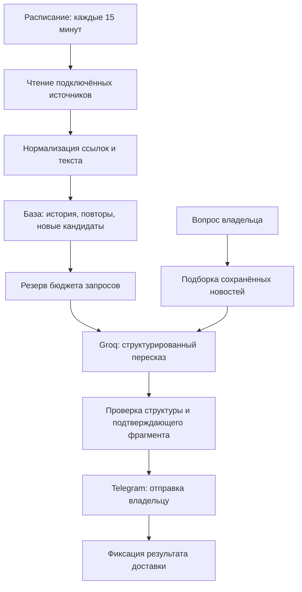

# Устройство рабочего агента

## Какие части можно изучить в этой витрине

В `src/core.mjs` опубликован реальный независимый модуль: очистка текста, допустимые ссылки источника, разбор RSS/Atom, состояние первой загрузки, тематические фильтры, запрос модели, проверка JSON и форматирование сообщения.

Расписание, обращения к базе, резерв бюджета и отправка Telegram показаны на схеме как части рабочего проекта. Их код и настройка личного окружения в этот репозиторий не включены.

## Поведение при ошибках

- Ошибка одного источника не должна останавливать остальные.
- Архив при подключении источника не рассылается как новая подборка.
- Решение модели привязано к конкретной входной публикации.
- При ограничении провайдера обработка откладывается.
- Неоднозначная доставка требует проверки: слепой повтор может прислать дубликат.

## Почему нет общедоступного Telegram-демо

Рабочий агент привязан к личному чату. Обычный посетитель не получает доступ к переписке и настройкам владельца. Кодовый пример позволяет проверить отдельную часть обработки без этого доступа. Реальные уведомления и диалог можно показать на собеседовании со своего экрана.
